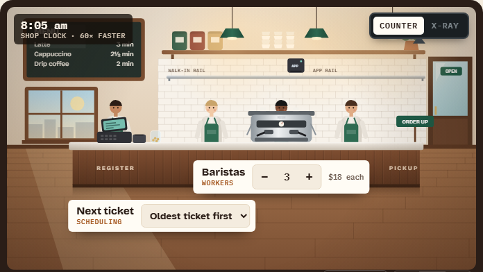
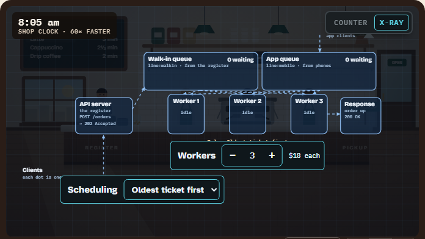

# Rush Hour

**Learn system design by running a coffee shop.** Design the shop, send in the morning rush, then flip on the X-ray to see the queues, workers, and APIs underneath.

### [▶ Play it in your browser](https://d1ecq5pg05xh78.cloudfront.net)

Free, no sign-up, works on phones.

| The counter | The X-ray: the same shop, as a system |
|---|---|
|  |  |

Every concept maps to something anyone who has stood in a coffee line already understands. A ticket rail is a queue. Calling your name is an asynchronous API. Steaming milk for two lattes is batching. A pastry case is a cache.

## How a level works

1. **Learn.** A short brief explains the idea in shop words, then in software terms.
2. **Design.** Tap the tags on the shop: hire baristas, add a ticket rail, choose who goes first.
3. **Make your call.** Predict what will happen before the rush.
4. **Play the rush.** Customers arrive; live goal meters show whether you're on track. The rush pauses at the key moment to point out what just happened.
5. **Read the receipt.** Goals met or missed, the numbers, what happened and why, and up to three stars.

## The menu

| # | At the coffee shop | In software | |
|---|---|---|---|
| 1 | Order at the register, then your name gets called | Async vs sync | ✅ Play |
| 2 | The order line | Queues | ✅ Play |
| 3 | Mobile orders vs walk-ins | Priority queues | ✅ Play |
| 4 | Steaming milk for several drinks at once | Batching | ✅ Play |
| 5 | Calling in more baristas | Autoscaling | ✅ Play |
| 6 | No box of coffee during the rush | Rate limiting | ✅ Play |
| 7 | Line out the door, pause mobile orders | Backpressure | ✅ Play |
| 8 | The pastry case | Caching | ✅ Play |
| 9 | Customer taps "order" twice, still one latte | Idempotency | Coming soon |
| 10 | "Is my drink ready?" every two seconds | Retries and backoff | Coming soon |
| 11 | New barista clocks in but isn't trained yet | Health checks | Coming soon |
| 12 | Espresso machine breaks, serve drip | Graceful degradation | Coming soon |

Several lessons come from how a real coffee shop runs: the no-boxes-in-the-rush rule, batching milk, pausing mobile orders when the line is out the door.

## The game isn't guessing

Behind the game is a real system: an order API, a Redis Streams queue, and baristas running as Pods on Kubernetes. The game is a simulation of that system, and it's held to it:

```
            shop/config.json  (menu, prep times, every rush)
                 │                          │
        the game (browser)           the real system (Kubernetes)
   event simulation, instant,      register API → Redis Streams → baristas
   free for every player           k6 sends the same customers, same times
                 │                          │
                 └──── calibration tests ───┘
               recorded real rushes vs the game:
                    10 of 10 within 10%
```

- **One settings file** drives both: the same customers arrive at the same moments in the game and on the cluster.
- **Recorded real rushes are replayed against the game** on every change. The tests fail if the game drifts.
- **Every level's verdict must survive timing noise.** Each clear pass or fail is re-run with every arrival nudged by a few seconds. This rule came from a [postmortem](docs/postmortems/2026-11-12-fragile-level-4-3.md), when a level passed one day and failed the next on the real cluster.

Lessons 1 to 4 are calibrated against real rushes. Lessons 5 to 8 run in the game for now, on the same calibrated engine.

## Under the counter

| Layer | What runs it |
|---|---|
| Game | A discrete-event simulation in plain JavaScript, with no framework or build step. 167 tests with Node's test runner |
| Lesson site | Python and Jinja2 build static pages, served from S3 behind CloudFront |
| The shop | Python and FastAPI (register), Python workers (baristas), Redis Streams (the line) |
| Load | k6 Jobs inside the cluster, capped by a namespace quota |
| Kubernetes | k3s: k3d on a laptop, one EC2 server in the cloud |
| Observability | kube-prometheus-stack trimmed for one node (95k → 37k samples per scrape), and a Grafana dashboard with the game's goals as SLOs |
| Cloud | AWS, built entirely with Terraform |

### Production details worth a look

- **No inbound traffic at all.** The server's security group has zero inbound rules. It's reached only through AWS Systems Manager, with no SSH keys and no open ports, and allows outbound HTTPS and HTTP only.
- **Short-lived credentials.** kubectl gets a 4-hour token for a dedicated operator account. The cluster's admin certificate never leaves the server. IMDSv2 is required, and the disk and Kubernetes Secrets are encrypted.
- **Least privilege.** The deploy identity can only manage IAM roles named `rush-hour-*` ([policy](infra/bootstrap/rush-hour-admin-policy.json)). The server's role can only use SSM and pull images.
- **Locked-down workloads.** A NetworkPolicy lets only the shop reach Redis. The shop's and the load generator's namespaces enforce Kubernetes' `restricted` Pod security standard; only monitoring is exempt, because node metrics need host access. Every shop and load-generator container runs as non-root, with resource limits and a read-only filesystem.
- **About $2 a month.** The game runs in each player's browser, so traffic costs nothing extra. The server runs only for demos and stops itself two ways: after 4 hours, or after an hour near idle. Budget alerts at $1, $5, $20, and $30 were set up before anything else.
- **Postmortems for what broke**, including on purpose: [docs/postmortems](docs/postmortems/).

## Run it yourself

You need Docker Desktop, [k3d](https://k3d.io), `kubectl`, [Helm](https://helm.sh), Node 20+, and Python 3.13. The scripts are PowerShell.

```powershell
.\scripts\site.ps1              # Build the game and lessons, serve at http://127.0.0.1:8080
cd web; npm test                # Engine, levels, stars, live meters, calibration, robustness

.\scripts\up.ps1                # The real system on a local k3d cluster, with monitoring
.\scripts\rush.ps1              # Send a 50-order rush and check every order gets made
.\scripts\rush.ps1 -KillBarista # Same, but kill a barista partway through
.\scripts\rush.ps1 -Rush lesson-3-2 -Baristas 3 -Rule weighted -Every 5   # Replay a game level for real
.\scripts\grafana.ps1           # Open the "Rush Hour" dashboard through a private tunnel
k3d cluster delete rush-hour    # Remove everything
```

Running it on AWS (Terraform, deploy scripts, start, stop, teardown) is in the [AWS runbook](docs/aws.md).

## Layout

| Folder | What's there |
|---|---|
| [`web/`](web/) | The game: the shop engine, the lessons' levels and briefs, and the tests |
| [`lessons/`](lessons/) | The site generator, page templates, and lesson text |
| [`services/`](services/) | The register (order API) and the baristas (workers) |
| [`shop/config.json`](shop/config.json) | Shop settings shared by the game and the cluster |
| [`k8s/`](k8s/) | Kubernetes config: the shop, the rush, and monitoring |
| [`infra/`](infra/) | Terraform: budgets and state (`bootstrap`), the site, registry, network, and server (`live`) |
| [`scripts/`](scripts/) | Bring the system up, send rushes, build and deploy |
| [`docs/`](docs/) | The design, the AWS runbook, and postmortems |

## Credits

Fonts: Bricolage Grotesque, Atkinson Hyperlegible, and IBM Plex Mono, under the SIL Open Font License ([`web/static/fonts`](web/static/fonts/)).
